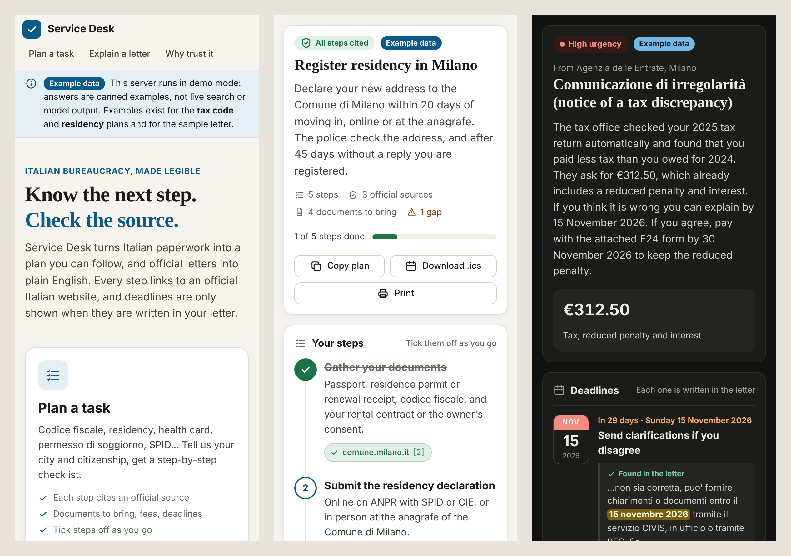
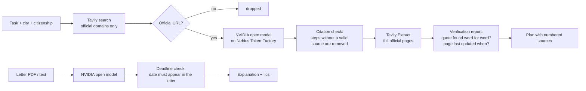

# Service Desk

**Italian bureaucracy, explained step by step, with every step linked to an official source.**

Moving to Italy means a codice fiscale, residency at the comune, the health service, maybe a permesso di soggiorno, SPID, an ISEE... Each office has its own rules, the pages are in Italian, and the advice on forums is often out of date. Then the letters arrive: *comunicazione di irregolarità*, *avviso di pagamento*, and you have no idea if it's urgent.

Service Desk is a personal assistant for exactly that:

1. **Plan a task.** Pick what you need to do, your city and citizenship. Service Desk searches **only official Italian websites** (gov.it, Agenzia delle Entrate, INPS, comuni...) and writes a step-by-step plan where **every step cites its source**. Steps the model could not back with a source are removed and you are told what is missing. Then a **verification report** checks each claim against the page itself: the supporting sentence must appear word for word on the cited official page (read in full with Tavily Extract), and each page's own "last updated" date is shown, with a warning when it is over two years old. Plans in English or Italian.
2. **Explain a letter.** Upload or paste an official letter. You get a plain-English summary, what to do, amounts, urgency, the Italian words worth knowing, and deadlines you can add to your calendar. A deadline is only shown if that exact date appears in the letter.

| Plan a task | Explain a letter |
|---|---|
|  |  |



*Screenshots show demo mode: canned example answers, labelled "Example data" in the interface (see [Try it without API keys](#try-it-without-api-keys)).*

## The interface

One self-contained page (`service_desk/static/index.html`, no external scripts, fonts or CDNs).

- **Two paths from the home page**: *Plan a task* and *Explain a letter*, plus shortcuts to popular tasks.
- **Task picker as searchable cards**: ten tasks, from the codice fiscale and residency to converting a driving licence, registering a lease and opening a partita IVA, plus a "Something else" card for your own question (same rules: official sources only).
- **Plan as a checklist.** Numbered steps you can tick off, each with its source as a badge (domain + link), where to go, cost and time when the sources state them. Documents to bring are a second checklist. Ticks are saved in your browser only. *Copy plan* puts the whole plan, with source URLs, on the clipboard; *Download .ics* creates reminders for the deadline rules on dates you choose; *Print* gives a clean printout.
- **Letter explained.** Upload a PDF or `.txt` (drag and drop works) or paste the text, or try the fictional sample letter. You get urgency, sender, a summary, the amount, what to do next, words to know and the deadlines, each with a countdown and **the sentence from the letter where the date appears, highlighted**. Explanations can be in English or Italian.
- **"Why trust it"** explains the grounding rules and lists the allowed domains.
- **Honest states**: loading skeletons, friendly errors with a retry button, and a setup banner when `NEBIUS_API_KEY` or `TAVILY_API_KEY` is missing (the server reports *whether* each key is set, never its value).
- Light and dark mode (follows the system), works at phone width, keyboard and screen-reader friendly (real form controls, labels, live regions, visible focus, reduced motion respected).

## How it works



- **Grounding, enforced in code.** The model must cite source numbers. Citations to sources that don't exist are dropped, and items left with no valid citation are removed and reported as gaps. If the search finds no official page, the model is not called at all.
- **A verification report on every plan, computed in code.** The model must give, for each step, document and deadline, a short passage copied word for word from a source it cites. Service Desk then reads the cited official pages in full with **Tavily Extract** (one basic call, 1 credit per 5 pages) and checks that passage against the page and the search excerpt (ignoring case, curly quotes and spacing; an ellipsis may join parts that appear in order). A found passage is shown under the step as the page's own words, with the domain and retrieval date; a passage that is not on the page is never shown, and the item is marked "cited, no exact sentence found". From the full page it also reads the date the page states about itself (`Ultimo aggiornamento: 12/03/2025`, `Data di pubblicazione`, `aggiornato il 5 maggio 2025`...) and flags pages older than two years. The report gives the counts: claims quoted word for word, items removed for lacking a source, pages read in full, pages dated and stale. If the extract call fails, quotes are still checked against the excerpts and the report says so.
- **Two domain filters.** Tavily's `include_domains` restricts the search, and Service Desk checks every returned URL again against the allowlist (it rejects look-alikes such as `agenziaentrate.gov.it.evil.com`).
- **Deadlines are never invented.** A date from the letter explanation is kept only if it is written in the letter (ISO, `30/11/2026`, `30.11.2026` or `30 novembre 2026`), and not merely as part of another date (`5/11/2026` does not match inside `25/11/2026`). The API returns the matching text and the sentence around it, and the UI shows it.
- **Privacy.** Nothing is stored on the server. Letters are sent to the model for one answer and dropped. Ticked steps and the last plan live in your browser's local storage.
- **Open models.** Inference runs on [Nebius Token Factory](https://tokenfactory.nebius.com) with an NVIDIA open model, **Nemotron 3 Super** (`nvidia/nemotron-3-super-120b-a12b`), through its OpenAI-compatible API, so the same code runs on any self-hosted OpenAI-compatible server. See [Which model and why](#which-model-and-why).
- **Robust to how the model answers.** The model is asked for JSON (`response_format: json_object`), but the reply is still parsed defensively: `<think>` blocks, a separate reasoning field, ```` ```json ```` fences and prose around the object are all handled. If a model rejects an optional request field (JSON mode, reasoning effort), Service Desk retries once without it and remembers. Rate limits (429), overload (503/529) and dropped connections are retried with `Retry-After`; every other failure becomes a readable message (bad key, budget exhausted, unknown model, Tavily credit limit) and a retry button in the UI.

## Run it

You need two keys:

- **Nebius Token Factory**: create one at [tokenfactory.nebius.com](https://tokenfactory.nebius.com) (API keys). Requests go to `https://api.tokenfactory.nebius.com/v1/chat/completions` with `Authorization: Bearer <key>`.
- **Tavily**: create one at [app.tavily.com](https://app.tavily.com) (keys start with `tvly-`). Requests go to `https://api.tavily.com/search` and `https://api.tavily.com/extract` with `Authorization: Bearer <key>`. Each plan makes one *advanced* search (2 credits) and one *basic* extract of up to 6 official pages (1 credit per 5 pages read).

```bash
pip install -r requirements.txt
export NEBIUS_API_KEY=...
export TAVILY_API_KEY=tvly-...
python scripts/smoke_test.py       # optional: checks both keys end to end
uvicorn service_desk.main:app --reload
```

Then open http://localhost:8000.

### Public demo on Render

[](https://render.com/deploy?repo=https://github.com/carlogiovannifalocco-byte/service-desk)

`render.yaml` runs the same image on Render's free plan with real keys: enter `NEBIUS_API_KEY` and `TAVILY_API_KEY` when Render asks. A public demo spends your quota, so three variables keep it in check: `CACHE_SECONDS` answers an identical request from memory (6 hours), `PER_IP_HOURLY_LIMIT` caps fresh requests per visitor (10 an hour) and `DAILY_LIMIT` caps them in total (40 a day; a plan costs about 4 Tavily credits). Over a limit the page says so in plain words. All three default to off, so a local run is never throttled. A free instance sleeps after 15 minutes, so the first visit after that takes about a minute.

### Check your keys in one command

`python scripts/smoke_test.py` first lists the `nvidia/` models your Nebius key can use (`GET /v1/models`, the one in use is marked), then makes the real calls the app makes: one Tavily search, one cited plan (*tax code*, Milano, Brazil: search + model) and one explanation of the fictional sample letter (model only). It prints the official URLs found, the cited steps, the deadlines found in the letter and how long the search and the model took, and ends with `ALL OK` (exit code 0) or says which step failed and why. It costs about 5 Tavily credits and a few thousand tokens, and also prints the verification report (quotes found word for word, pages read with Tavily Extract).

Or with Docker: `docker build -t service-desk . && docker run -p 8000:8000 -e NEBIUS_API_KEY -e NEBIUS_MODEL -e TAVILY_API_KEY service-desk`.

| Variable | Default | |
|---|---|---|
| `NEBIUS_API_KEY` | required | Token Factory key |
| `NEBIUS_BASE_URL` | `https://api.tokenfactory.nebius.com/v1` | Any OpenAI-compatible endpoint works |
| `NEBIUS_MODEL` | `nvidia/nemotron-3-super-120b-a12b` | Any chat model id from the Token Factory model list |
| `NEBIUS_REASONING_EFFORT` | not sent | Optional `reasoning_effort` (`low`, `medium`, `high`...) for faster or deeper answers; dropped automatically if the model rejects it |
| `NEBIUS_MAX_TOKENS` | `8192` | Output budget per answer, reasoning tokens included |
| `NEBIUS_TIMEOUT` | `180` | Seconds to wait for the model |
| `TAVILY_API_KEY` | required | Tavily search |
| `SERVICE_DESK_DEMO` | off | `1` serves canned example answers instead of calling Tavily and Nebius |

### Which model and why

**NVIDIA Nemotron 3 Super** (`nvidia/nemotron-3-super-120b-a12b`, open weights, a mixture-of-experts model with 120B parameters, 12B active per token) on Token Factory.

- It is an NVIDIA open model called at runtime through Token Factory, which is what the hackathon rules ask for; the Best Apps and Agents track suggests Nemotron models on Token Factory (Ultra for heavy reasoning, Nano or Super for fast calls).
- The id is the one in Nebius's own [Nemotron code sample](https://nebius.com/services/token-factory/nemotron), and the model Nebius [recommends as the replacement](https://docs.tokenfactory.nebius.com/august-2026-deprecation-notice) for the Llama 3.1 Nemotron Ultra model it retired on 31 August 2026. Token Factory does not reroute retired ids, so the default is an id Nebius currently documents.
- The plan prompt carries up to six official pages and asks for a structured answer where every item cites a source number. That is a reading-and-reasoning task more than a writing one, so a reasoning model with a long context is a better fit than the smallest, fastest option; anything it cites wrongly is still removed by the citation check.
- It is a reasoning model. Its thinking is kept out of the answer (Service Desk reads only the JSON), and `NEBIUS_MAX_TOKENS` leaves room for it.

For faster, cheaper answers, `NEBIUS_MODEL=nvidia/Nemotron-3_5-Lightning` is the smaller Nemotron that Nebius recommends in the same deprecation notice; the smoke test shows whether your key can use it. The model list in your Token Factory console is the source of truth; `NEBIUS_BASE_URL` also accepts a regional endpoint such as `https://api.tokenfactory.us-central1.nebius.com/v1`.

## Measure it: citation evaluation

`python scripts/eval_citations.py` runs a fixed set of 12 requests (all ten tasks across six cities and several citizenships, plus a free-text question) through the real pipeline and writes `eval/results-<date>.json` with a Markdown table. Per request and in total it reports: claims kept, items removed for lacking a source, the share of claims whose quote was found word for word on the cited official page, pages read in full, pages that state an update date and how many are over two years old, whether every source passed the official-domain check, and the time taken. Every number comes from a run anyone can repeat; nothing is estimated. A live run costs about 4 Tavily credits and one model call per request. `--demo` runs it on the canned data, only to check the script (its output is labelled as not a measurement).

**Results:** not published yet. They will be added here from the first live run with the hackathon keys.

## Try it without API keys

```bash
SERVICE_DESK_DEMO=1 uvicorn service_desk.main:app
```

Demo mode replaces search and the model with canned answers (`service_desk/demo.py`): the *tax code* and *residency* plans, and the fictional sample letter in English and Italian. Every page then shows an **Example data** banner, and results carry an *Example data* tag, so nobody mistakes them for live answers. The canned answers still go through the real citation filter, quote check and deadline check. Demo mode reads no full pages, so its verification report shows quotes checked against the canned excerpts and no page dates. Other tasks show the honest "no official source found" result.

`scripts/screenshots.py` regenerates the screenshots in `docs/` from a running demo instance (needs `playwright` and `pillow`).

## API

- `GET /api/tasks`: supported tasks
- `GET /api/config`: what the UI needs: demo mode, whether each API key is set (true/false only), model id, allowed domains, tasks with display names
- `GET /api/health`: `{"status": "ok"}`
- `POST /api/plan` `{"task", "city", "nationality", "situation", "question", "lang"}`: cited plan. `task` is one of `/api/tasks`, or `"other"` with your own `question`; `lang` is `en` (default) or `it`. Steps may carry `cost` and `time` when the sources state them. Every step, document and deadline has `quote`, `quote_source` and `verified`; every source has `retrieved_at`, `page_read` and `updated` (`{date, text, stale}` or null); `verification` holds the report totals.
- `POST /api/letter`: multipart `file` (PDF/text) or form field `text`, optional `lang` (`en` default, or `it`). Each deadline comes with `match` (the date as written) and `quote` (the text around it).
- `GET /api/sample-letter`: a fictional letter to try the explainer
- `POST /api/calendar.ics` `{"events": [{"what", "date"}]}`: calendar file with a reminder 3 days before

## Tests

```bash
pip install -r requirements-dev.txt
pytest
```

They cover the exact request shapes sent to Tavily and Token Factory (URL, bearer header, parameters, the 400-character Tavily query limit), parsing the model's JSON out of `<think>` blocks, code fences, reasoning fields and surrounding prose, retries on 429/503/529 with `Retry-After`, falling back when a model rejects JSON mode, readable errors for bad keys, exhausted budgets and unknown models, the domain allowlist (including look-alike hosts), filtering of unofficial search results, removal of uncited steps and invalid citations, skipping the model when there are no sources, free-text questions, deadline verification against the letter text (including dates hidden inside other dates) and the quote shown for each deadline, the explanation language, PDF upload, the verification report (quotes found only on the cited page, reworded or misattributed quotes rejected, ellipses, curly quotes, page update dates in Italian formats, impossible and future dates ignored, staleness, the fallback to excerpts when Tavily Extract fails, the Extract request shape and errors), plans in Italian, the evaluation script in demo mode, the config endpoint not leaking keys, demo mode going through the real checks, `.ics` escaping, and API errors. External services are always mocked.

## Not legal advice

Service Desk helps you prepare. Rules change and differ between comuni: always confirm with the office.

## License

MIT
