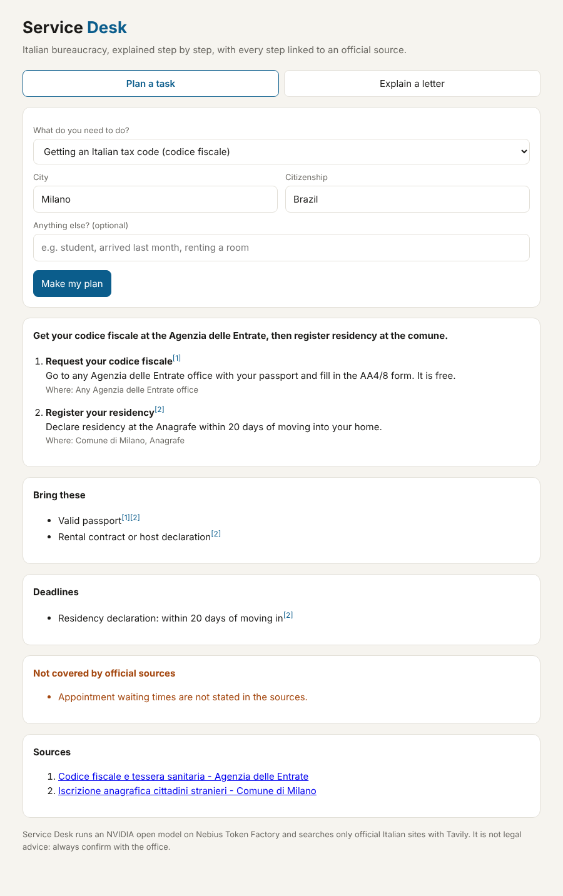
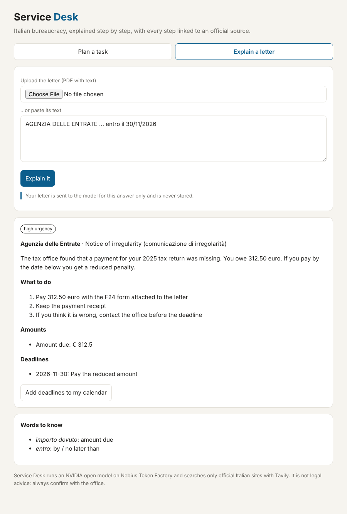
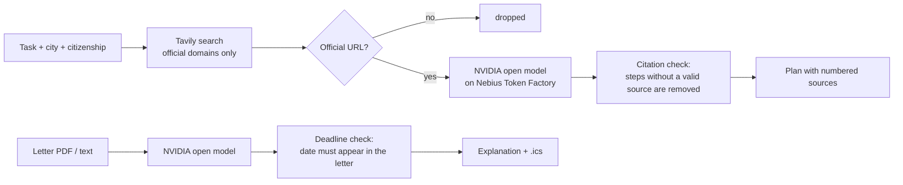

# Service Desk

**Italian bureaucracy, explained step by step, with every step linked to an official source.**

Moving to Italy means a codice fiscale, residency at the comune, the health service, maybe a permesso di soggiorno, SPID, an ISEE... Each office has its own rules, the pages are in Italian, and the advice on forums is often out of date. Then the letters arrive: *comunicazione di irregolarità*, *avviso di pagamento*, and you have no idea if it's urgent.

Service Desk is a personal assistant for exactly that:

1. **Plan a task.** Pick what you need to do, your city and citizenship. Service Desk searches **only official Italian websites** (gov.it, Agenzia delle Entrate, INPS, comuni...) and writes a step-by-step plan where **every step cites its source**. Steps the model could not back with a source are removed and you are told what is missing.
2. **Explain a letter.** Upload or paste an official letter. You get a plain-English summary, what to do, amounts, urgency, the Italian words worth knowing, and deadlines you can add to your calendar. A deadline is only shown if that exact date appears in the letter.

| Plan a task | Explain a letter |
|---|---|
|  |  |

*Screenshots show the interface with example data.*

## How it works



- **Grounding, enforced in code.** The model must cite source numbers. Citations to sources that don't exist are dropped, and items left with no valid citation are removed and reported as gaps. If the search finds no official page, the model is not called at all.
- **Two domain filters.** Tavily's `include_domains` restricts the search, and Service Desk checks every returned URL again against the allowlist (it rejects look-alikes such as `agenziaentrate.gov.it.evil.com`).
- **Deadlines are never invented.** A date from the letter explanation is kept only if it is written in the letter (ISO, `30/11/2026`, `30.11.2026` or `30 novembre 2026`).
- **Privacy.** Nothing is stored. Letters are sent to the model for one answer and dropped.
- **Open models.** Inference runs on [Nebius Token Factory](https://tokenfactory.nebius.com) with an NVIDIA open model (Nemotron family) through its OpenAI-compatible API, so the same code runs on any self-hosted OpenAI-compatible server.

## Run it

```bash
pip install -r requirements.txt
export NEBIUS_API_KEY=...          # Nebius Token Factory
export NEBIUS_MODEL=...            # an NVIDIA Nemotron model id from the Token Factory model list
export TAVILY_API_KEY=...
uvicorn service_desk.main:app --reload
```

Or with Docker: `docker build -t service-desk . && docker run -p 8000:8000 -e NEBIUS_API_KEY -e NEBIUS_MODEL -e TAVILY_API_KEY service-desk`.

| Variable | Default | |
|---|---|---|
| `NEBIUS_API_KEY` | required | Token Factory key |
| `NEBIUS_BASE_URL` | `https://api.tokenfactory.nebius.com/v1` | Any OpenAI-compatible endpoint works |
| `NEBIUS_MODEL` | `nvidia/Llama-3_3-Nemotron-Super-49B-v1_5` | Check the exact id in the Token Factory console |
| `TAVILY_API_KEY` | required | Tavily search |

## API

- `GET /api/tasks`: supported tasks
- `POST /api/plan` `{"task", "city", "nationality", "situation"}`: cited plan
- `POST /api/letter`: multipart `file` (PDF/text) or form field `text`
- `POST /api/calendar.ics` `{"events": [{"what", "date"}]}`: calendar file with a reminder 3 days before

## Tests

```bash
pip install -r requirements-dev.txt
pytest
```

They cover the domain allowlist (including look-alike hosts), filtering of unofficial search results, removal of uncited steps and invalid citations, skipping the model when there are no sources, deadline verification against the letter text, `.ics` escaping, and API errors.

## Not legal advice

Service Desk helps you prepare. Rules change and differ between comuni: always confirm with the office.

## License

MIT
