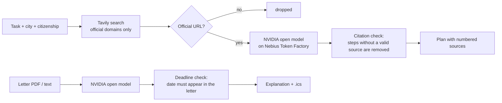

# Service Desk

**Italian bureaucracy, explained step by step, with every step linked to an official source.**

Moving to Italy means a codice fiscale, residency at the comune, the health service, maybe a permesso di soggiorno, SPID, an ISEE... Each office has its own rules, the pages are in Italian, and the advice on forums is often out of date. Then the letters arrive: *comunicazione di irregolarità*, *avviso di pagamento*, and you have no idea if it's urgent.

Service Desk is a personal assistant for exactly that:

1. **Plan a task.** Pick what you need to do, your city and citizenship. Service Desk searches **only official Italian websites** (gov.it, Agenzia delle Entrate, INPS, comuni...) and writes a step-by-step plan where **every step cites its source**. Steps the model could not back with a source are removed and you are told what is missing.
2. **Explain a letter.** Upload or paste an official letter. You get a plain-English summary, what to do, amounts, urgency, the Italian words worth knowing, and deadlines you can add to your calendar. A deadline is only shown if that exact date appears in the letter.

| Plan a task | Explain a letter |
|---|---|
|  |  |


*Screenshots show demo mode: canned example answers, labelled "Example data" in the interface (see [Try it without API keys](#try-it-without-api-keys)).*

## The interface

One self-contained page (`service_desk/static/index.html`, no external scripts, fonts or CDNs).

- **Two paths from the home page**: *Plan a task* and *Explain a letter*, plus shortcuts to popular tasks.
- **Task picker as searchable cards**, with a "Something else" card for your own question (same rules: official sources only).
- **Plan as a checklist.** Numbered steps you can tick off, each with its source as a badge (domain + link), where to go, cost and time when the sources state them. Documents to bring are a second checklist. Ticks are saved in your browser only. *Copy plan* puts the whole plan, with source URLs, on the clipboard; *Download .ics* creates reminders for the deadline rules on dates you choose; *Print* gives a clean printout.
- **Letter explained.** Upload a PDF or `.txt` (drag and drop works) or paste the text, or try the fictional sample letter. You get urgency, sender, a summary, the amount, what to do next, words to know and the deadlines, each with a countdown and **the sentence from the letter where the date appears, highlighted**. Explanations can be in English or Italian.
- **"Why trust it"** explains the grounding rules and lists the allowed domains.
- **Honest states**: loading skeletons, friendly errors with a retry button, and a setup banner when `NEBIUS_API_KEY` or `TAVILY_API_KEY` is missing (the server reports *whether* each key is set, never its value).
- Light and dark mode (follows the system), works at phone width, keyboard and screen-reader friendly (real form controls, labels, live regions, visible focus, reduced motion respected).

## How it works



- **Grounding, enforced in code.** The model must cite source numbers. Citations to sources that don't exist are dropped, and items left with no valid citation are removed and reported as gaps. If the search finds no official page, the model is not called at all.
- **Two domain filters.** Tavily's `include_domains` restricts the search, and Service Desk checks every returned URL again against the allowlist (it rejects look-alikes such as `agenziaentrate.gov.it.evil.com`).
- **Deadlines are never invented.** A date from the letter explanation is kept only if it is written in the letter (ISO, `30/11/2026`, `30.11.2026` or `30 novembre 2026`), and not merely as part of another date (`5/11/2026` does not match inside `25/11/2026`). The API returns the matching text and the sentence around it, and the UI shows it.
- **Privacy.** Nothing is stored on the server. Letters are sent to the model for one answer and dropped. Ticked steps and the last plan live in your browser's local storage.
- **Open models.** Inference runs on [Nebius Token Factory](https://tokenfactory.nebius.com) with an NVIDIA open model (Nemotron family) through its OpenAI-compatible API, so the same code runs on any self-hosted OpenAI-compatible server.

## Run it

```bash
pip install -r requirements.txt
export NEBIUS_API_KEY=...          # Nebius Token Factory
export NEBIUS_MODEL=...            # an NVIDIA Nemotron model id from the Token Factory model list
export TAVILY_API_KEY=...
uvicorn service_desk.main:app --reload
```

Then open http://localhost:8000.

Or with Docker: `docker build -t service-desk . && docker run -p 8000:8000 -e NEBIUS_API_KEY -e NEBIUS_MODEL -e TAVILY_API_KEY service-desk`.

| Variable | Default | |
|---|---|---|
| `NEBIUS_API_KEY` | required | Token Factory key |
| `NEBIUS_BASE_URL` | `https://api.tokenfactory.nebius.com/v1` | Any OpenAI-compatible endpoint works |
| `NEBIUS_MODEL` | `nvidia/Llama-3_3-Nemotron-Super-49B-v1_5` | Check the exact id in the Token Factory console |
| `TAVILY_API_KEY` | required | Tavily search |
| `SERVICE_DESK_DEMO` | off | `1` serves canned example answers instead of calling Tavily and Nebius |

## Try it without API keys

```bash
SERVICE_DESK_DEMO=1 uvicorn service_desk.main:app
```

Demo mode replaces search and the model with canned answers (`service_desk/demo.py`): the *tax code* and *residency* plans, and the fictional sample letter in English and Italian. Every page then shows an **Example data** banner, and results carry an *Example data* tag, so nobody mistakes them for live answers. The canned answers still go through the real citation filter and deadline check. Other tasks show the honest "no official source found" result.

`scripts/screenshots.py` regenerates the screenshots in `docs/` from a running demo instance (needs `playwright` and `pillow`).

## API

- `GET /api/tasks`: supported tasks
- `GET /api/config`: what the UI needs: demo mode, whether each API key is set (true/false only), model id, allowed domains, tasks with display names
- `GET /api/health`: `{"status": "ok"}`
- `POST /api/plan` `{"task", "city", "nationality", "situation", "question"}`: cited plan. `task` is one of `/api/tasks`, or `"other"` with your own `question`. Steps may carry `cost` and `time` when the sources state them.
- `POST /api/letter`: multipart `file` (PDF/text) or form field `text`, optional `lang` (`en` default, or `it`). Each deadline comes with `match` (the date as written) and `quote` (the text around it).
- `GET /api/sample-letter`: a fictional letter to try the explainer
- `POST /api/calendar.ics` `{"events": [{"what", "date"}]}`: calendar file with a reminder 3 days before

## Tests

```bash
pip install -r requirements-dev.txt
pytest
```

They cover the domain allowlist (including look-alike hosts), filtering of unofficial search results, removal of uncited steps and invalid citations, skipping the model when there are no sources, free-text questions, deadline verification against the letter text (including dates hidden inside other dates) and the quote shown for each deadline, the explanation language, PDF upload, the config endpoint not leaking keys, demo mode going through the real checks, `.ics` escaping, and API errors. External services are always mocked.

## Not legal advice

Service Desk helps you prepare. Rules change and differ between comuni: always confirm with the office.

## License

MIT
